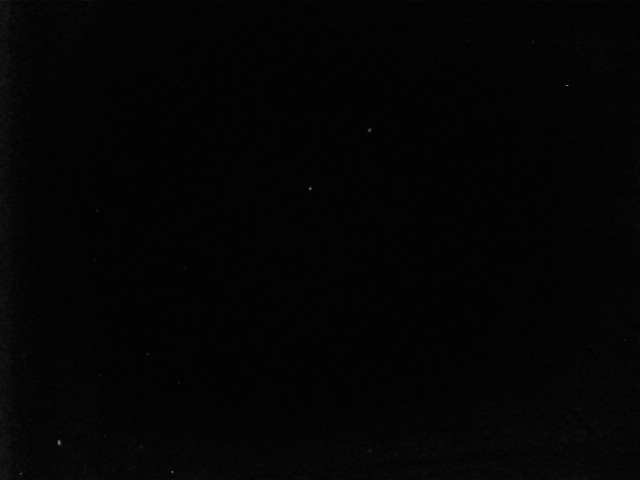
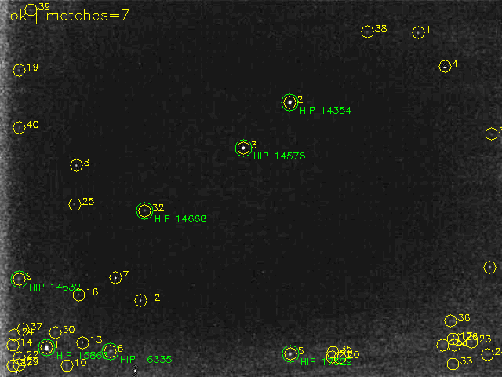

# Example fixtures

- `03.bmp`: original 640x480 hardware/camera capture provided by the user.
  The current examples preset solves7 stars; see the result and limitations below.
- `stellarium_test/stellarium_view.png`: 1920x1080 perspective Stellarium
  screenshot with `stars_labels.json`. The label FOV is **vertical** 16.9761 deg;
  the matching pipeline preset uses horizontal 29.717817 deg. Labels are read
  only after blind inference and are a pseudo-reference, not physical ground truth.
  The screenshot was collected with the former `data/extract_star.py`, now
  `tools/stellarium/extract_star.py`. See `docs/stellarium_image.md` to collect
  your own captures via Remote Control API.

The original source files are preserved. Generated annotated/debug images are
not fixtures and are ignored by Git, except the reviewed documentation snapshots
in `docs/assets/image03-*.png`. Run `examples/run_image_examples.py` to
create overlays from actual detections/matches. Databases are external assets;
see `examples/materialize_assets.sh` and `examples/generate_tetra_database.py`.

## Image03 hardware camera capture

Ảnh `03.bmp` được người dùng xác nhận thu từ **phần cứng/camera**, không phải
fixture screenshot trực tiếp như `stellarium_test`. Chưa có metadata đầy đủ về
camera, lens, exposure hay xác nhận camera chụp trời thật hoặc màn hình giả lập;
không suy diễn đây là ảnh trên quỹ đạo hoặc ground truth phần cứng độc lập.

### Ảnh đầu vào

PNG bên dưới là bản chuyển lossless từ grayscale của `03.bmp`, **không tăng sáng**.
Pipeline đọc trực tiếp [BMP gốc](03.bmp), không đọc ảnh annotation.



### Kết quả examples hiện tại

| Thông số | Kết quả |
|---|---:|
| Preset | `configs/examples/image03-experimental.json` |
| Trạng thái | `ok` |
| Candidate / sao khớp | 40 / 7 |
| Tâm RA / Dec | 48.816336° / 41.369726° |
| HFOV solver tìm được | 16.747193° |
| Residual fit RMSE | 38.896 arcsec |
| Sai lệch tâm so với screenshot Astrometry | ≈0.033024° |
| Sai số quaternion/roll độc lập | Chưa xác định: thiếu WCS gốc |



Ảnh kết quả chỉ tăng sáng8 lần để **hiển thị**, không tác động input solver.
Vòng vàng/số thứ tự là candidate; nhãn HIP xanh là ID thực sự do solver trả về:
15863, 14576, 14354, 17529, 14668, 14632, 16335. Không dùng nhãn sao gán tay
Andromeda/Ophiuchus cũ để suy ra kết quả.

Chạy từ repo root, Python3.10:

```bash
.venv/bin/python examples/run_image_examples.py --output-dir out/image-examples
```

Runner ghi JSON, bảng kết quả và ảnh vào `out/image-examples/`. Có thể chạy dạng
module: `.venv/bin/python -m examples.run_image_examples`.

FOV16.8° lấy từ calibration trên screenshot Astrometry job17182488; tâm RA/Dec,
roll và nhãn không được đưa vào solver. Reference chỉ được đọc sau inference.
Đây là blind sky-location solving **với FOV đã cung cấp**, là kết quả development
trên một ảnh, không phải accuracy held-out trên DUST/LOST. Chỉ biết sai lệch tâm
xấp xỉ so với screenshot làm tròn, chưa có WCS để chấm attitude đầy đủ.

So với preset image03 trước: giữ nguyên detector/Top-Hat31/component mask/flux
ranking, đổi FOV28±10° thành16.8±0.8°, giữ40 candidate và input cap40,
verification catalog tối đa90 sao, siết radius9.6→1.92px. Ngưỡng xác suất0.001
không đổi. Preset cũ `image03.json` và mặc định benchmark được giữ nguyên.
Xem [phân tích và đối chứng](../docs/image03-experimental.md).
