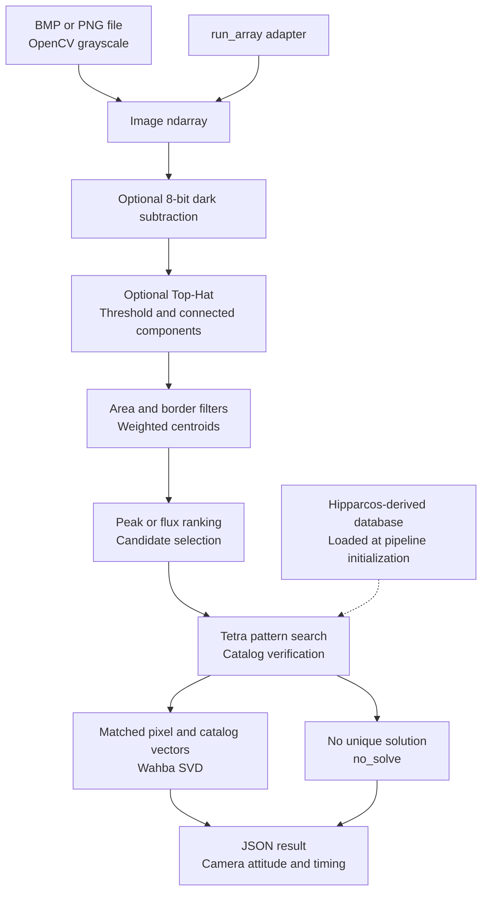
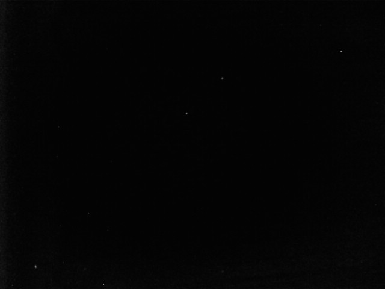
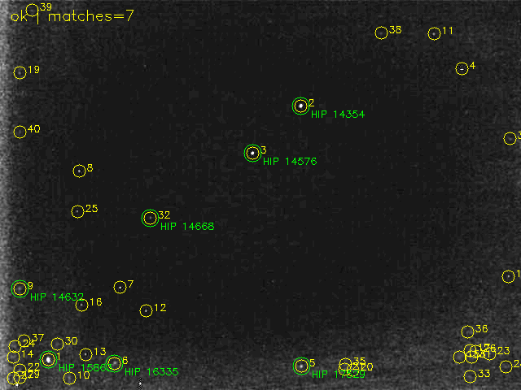
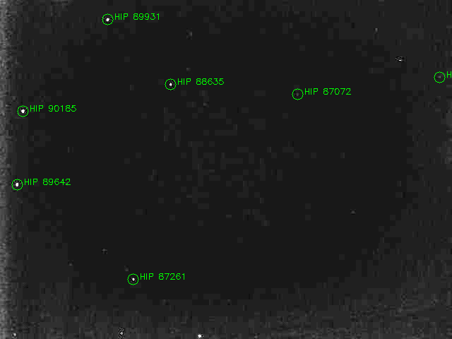
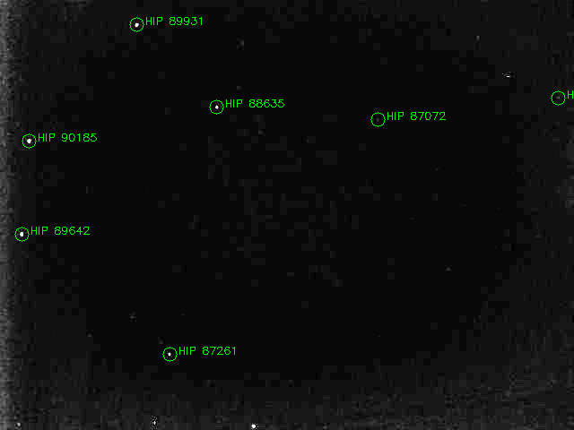

# USSEG — hiện trạng và kết quả làm baseline cho version 3

Ngày tổng hợp: 2026-11-04. Code baseline: `33d9c17` (`dev/version2`).
Đây là báo cáo baseline trước runtime. Version3 đã có implementation;
xem [báo cáo triển khai](version3-report.md). Chưa build/test container trên máy đích.

## 1. Pipeline Python đang có



Source: `models/pipeline/pipeline.py`, `models/detector/star_detector.py`,
`models/identifier/plate_solver.py`, `utils/dark_frame.py`.
Public solver accepts centroid XY; internal Tetra uses YX. Quaternion public
`wxyz` maps inertial catalog → camera. C++ voting/QUEST/tracking là nhánh xử lý
khác; test C++ không xác nhận độ chính xác pipeline Python trên ảnh camera.

Chưa có raw RG10/RG12 decoder, directory queue, supervisor hard deadline, resume
và container entrypoint. File loader hiện đọc grayscale; detector vẫn ép uint8.
Dark subtraction hiện chỉ nhận ảnh 8-bit. Các giới hạn này phải giải quyết trước
khi áp dụng cho buffer RAW camera bên bay.

## 2. Kết quả ảnh development đã đo

Các hàng dưới là kết quả các lần chạy 2026-10-25/27 đã lưu, không phải benchmark
mới trên phần cứng bay. Test Python được chạy lại ngày 2026-11-04 ở phần sau.

| Input / config | Candidate | Matches | RA / Dec (độ) | HFOV tìm được | Reference |
|---|---:|---:|---|---:|---|
| 03.bmp / experimental | 40 | 7 | 48.816336 / 41.369726 | 16.747193° | Tâm lệch khoảng0.033024° so screenshot Astrometry |
| Stellarium tracked / preset | 20 | 16 | 291.950409 / 41.128080 | 29.712974° | 16/16 ID pairs đúng; attitude error0.002738° |
| 200701.bmp raw / experimental | 22 | 7 | 267.250966 / −31.683422 | 16.767348° | Chưa có WCS/nhãn riêng |
| 200701_calibrated.bmp / experimental | 20 | 7 | 267.256413 / −31.683188 | 16.765450° | Chưa có WCS/nhãn riêng |

Ảnh03 và200701 là ảnh user đưa để test phần cứng; chưa đủ capture metadata để
chứng nhận geometry/attitude độc lập. Ảnh03 có screenshot plate solving hỗ trợ
đối chiếu tâm. Chưa có WCS gốc để chấm full quaternion/roll. 200701 dùng lại
HFOV16.8° và preset lab, không được lấy reference ảnh03 để chấm field mới.
Raw/calibrated200701 cùng7 HIP IDs; residual fit RMSE lần lượt42.42″/42.70″.
Đây là mức khớp nội bộ, không phải attitude error độc lập. Dark calibration
giảm22→20 candidate nhưng chưa chứng minh attitude tốt hơn.

### Ảnh03





### Ảnh200701

Input: [BMP gốc](../dataset/200701.bmp) và
[BMP calibrated](../dataset/calibration/openmv/session_01/200701_calibrated.bmp).
Ảnh dưới là solver annotation, gain8 chỉ để hiển thị.





### Đối chứng thay đổi cho ảnh03

| Thay đổi | Kết quả |
|---|---|
| Preset cũ | no_solve |
| Chỉ sửa HFOV thành16.8° | no_solve |
| HFOV16.8° + radius0.003 | 6 matches |
| HFOV16.8° + radius0.003 + input40 + catalog90 | 7 matches |

Detector và threshold không thay đổi trong đối chứng này. Ngưỡng mismatch vẫn0.001;
catalog verification mở rộng được tính vào xác suất. 7 matches không tự chứng minh
attitude tốt hơn6 matches (sai lệch tâm tương ứng khoảng0.033° và0.031°).
Stellarium với verifier opt-in có17 pairs đúng nhưng attitude error0.003312°,
so với16 pairs và0.002738° ở preset. Vì vậy không áp opt-in mặc định cho mọi ảnh.

## 3. LOST-evals và DUST — baseline lịch sử

Nguồn: `lost-evals/out/version01/summary.md`, synthetic.csv và
`dust-final/dust-usseg-vs-lost-summary.md` tại workspace evaluator.
Bảng này là run version01 trước bổ sung dark/RAW/runtime version3.
Không dùng kết quả ảnh lab để thay các số liệu holdout này.

Synthetic100 frame/scenario, correct khi attitude error dưới0.5°:

| Scenario | LOST correct | USSEG correct | LOST compute P50 (ms) | USSEG compute P50 (ms) |
|---|---:|---:|---:|---:|
| 20° low noise | 98% | 90% | 3.088 | 767.420 |
| 20° high noise | 72% | 11% | 5.415 | 1180.001 |
| 45° low noise | 100% | 82% | 4.098 | 549.630 |
| 45° high noise | 91% | 42% | 7.923 | 908.784 |

Timeout USSEG600ms là soft timeout; thời gian thực có thể lớn hơn. Không chuyển
timing máy phát triển thành cam kết tốc độ trên CPU bay.

DUST mỗi track có1111 frames/17 test sessions,919 valid-WCS frames:

| Track / algorithm | Solved trên1111 | Correct trên919 WCS | Wrong trên919 WCS | Solved thiếu WCS |
|---|---:|---:|---:|---:|
| H5 LOST | 198 | 1 | 163 | 34 |
| H5 USSEG | 18 | 1 | 17 | 0 |
| PNG LOST | 51 | 0 | 51 | 0 |
| PNG USSEG | 12 | 3 | 9 | 0 |

PNG labeled-star recall38.429% USSEG so5.078% LOST, median matched centroid
residual0.346px so0.814px. Ưu thế detector không kéo theo full-pipeline attitude
availability. WCS là pseudo-ground-truth; Corr có thể không liệt kê mọi sao.
Không dùng catalog-set overlap làm correspondence-level star-ID precision.

## 4. Kiểm chứng hiện tại và mức sẵn sàng

2026-11-04, Python3.10.21, OpenCV/BLAS một thread:
`python -m pytest examples/tests -q` → **67 passed, 2 skipped** (external CSV).
Không phải tất cả test nghiệm thu bay: chưa test RAW hardware, Podman target,
power-loss, persistent queue, memory/time budget và soak theo cadence máy đích.
Máy hiện tại chưa có Podman. Chưa chứng nhận Python3.11–3.14 hay ARM64 dù
pyproject v2 mở dải Python rộng hơn.

NPZ default49,414,085 bytes; pattern table giải nén98,952,736 bytes, chưa gồm
các array/temporary khác. Cần đo peak RSS/cgroup trên máy đích. Tetra database
hiện tại range10–30°; profile ngoài range cần database phù hợp và benchmark riêng.

Kết luận dùng cho bàn giao: pipeline có bằng chứng solve trên một số ảnh lab,
nhưng holdout DUST còn nhiều wrong/no-solve. Version3 trước hết chuẩn hóa camera
input và khả năng vận hành; chưa có cơ sở gọi là flight-ready hoặc production-grade.

## 5. Bằng chứng và tái hiện

- [03 JSON](evidence/image03.json), [Stellarium JSON](evidence/stellarium.json).
- [200701 raw JSON](evidence/image200701-raw.json), [200701 calibrated JSON](evidence/image200701-calibrated.json).
- [Ablation03](evidence/image03-ablation.json).
- [Synthetic CSV](evidence/synthetic-version01.csv), [DUST baseline report](evidence/dust-version01.md).
- [Nguồn của từng snapshot](evidence/README.md).
- Metadata trong JSON có source/input/config hashes; absolute paths là đường dẫn
  máy thực hiện lần đo, không phải yêu cầu của container tương lai.

```bash
# Python 3.10, repo root; cần database đã materialize
OMP_NUM_THREADS=1 OPENBLAS_NUM_THREADS=1 .venv/bin/python -m examples.run_image_examples
OMP_NUM_THREADS=1 OPENBLAS_NUM_THREADS=1 .venv/bin/python -m examples.check_image03_experimental \
  --image dataset/200701.bmp --output-dir out/image200701-raw-new --noise-trials 0
OMP_NUM_THREADS=1 OPENBLAS_NUM_THREADS=1 .venv/bin/python -m examples.check_image03_experimental \
  --image dataset/calibration/openmv/session_01/200701_calibrated.bmp \
  --output-dir out/image200701-calibrated-new --noise-trials 0
```

`--noise-trials 0` bỏ negatives; không diễn giải 0/0 là đã pass test false-positive.
Output cũ được giữ để đối chiếu, không gán thời gian chạy hiện tại cho số liệu cũ.

## 6. Dọn tài liệu

Thay README dài/lặp ngôn ngữ và docs index bằng mục lục ngắn. Xóa7 tài liệu
đánh số01–07 khỏi working tree version3 vì trùng nội dung, có schema/hướng chạy
chưa khớp code hoặc trộn benchmark cũ với nhận định production. Nội dung cần thiết
được thay bằng báo cáo này và hợp đồng version3. Git commit `33d9c17` lưu toàn bộ
bản cũ; không xóa code, ảnh gốc, database hoặc output thí nghiệm.

Giữ `version01-validation.md` như lịch sử audit có gắn nhãn; giữ hướng dẫn Ubuntu,
Stellarium, dark-frame và các preset để tái hiện. Mục lục vận hành chỉ trỏ vào docs
còn hiệu lực; tài liệu cũ không dùng làm tiêu chí nghiệm thu version3.
