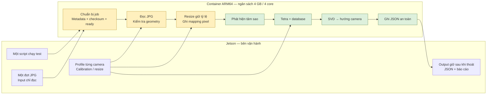
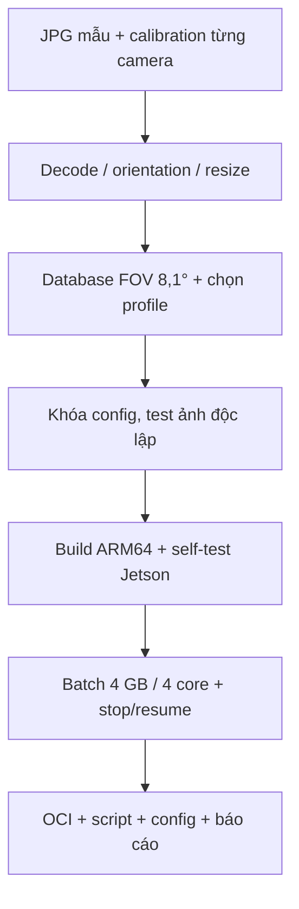

# Đặc tả triển khai USSEG trên Jetson — VinSpace

Ngày cập nhật: **05/11/2026**. Nhánh: `prod/version2`.
Mã nguồn thuật toán/runtime được kiểm thử tại revision `d494f0f`.

Phần mềm nhận ảnh sao theo đợt, xác định hướng camera và lưu kết quả JSON.
Tài liệu quy định kiến trúc triển khai, giao tiếp dữ liệu và các điều kiện
nghiệm thu trên phần cứng VinSpace.

[Hướng dẫn vận hành](operation.md) · [Báo cáo kiểm thử](validation.md)

## 1. Cấu hình triển khai

### 1.1. Đối chiếu hệ thống thử nghiệm và hệ thống triển khai

| Hạng mục | Hệ thống thử nghiệm hiện tại | Hệ thống VinSpace |
|---|---|---|
| Camera | OpenMV, nền tảng STM32; bảng thiết bị ghi Cam H7 Plus | Camera 16 MP / 24 MP, có cận hồng ngoại |
| Ống kính | Lens 12 mm, ngàm M12 theo bảng thiết bị | Tiêu cự 100 mm |
| Độ phân giải | 2592×1944 theo bảng thiết bị; ảnh mẫu đang xử lý 640×480 | Khoảng 5000×4000; cần kích thước thực theo camera |
| Góc nhìn | FOV chéo 21,7° theo bảng thiết bị; cấu hình xử lý dùng HFOV 16,8° | Ngang 8,1°; dọc 6,3°; chéo 9,96° |
| Thu nhận ảnh | OpenMV/STM32; ảnh mẫu xuất ra để xử lý trên máy tính | Ảnh JPG được mount vào thư mục input |
| Máy chạy thuật toán | Linux WSL2 amd64, Podman; chưa kiểm chứng pipeline Python chạy trên STM32 | Jetson CPU ARM, RAM thiết bị 8 GB; model/OS chờ xác nhận |
| Tài nguyên cấp cho phần mềm | Chưa áp quota trong lượt kiểm thử hiện tại | 4 GB RAM, 4 core; xác nhận aarch64 và GB/GiB |
| Cấu hình xử lý | Profile `lab640`, ảnh BMP/PNG 8-bit | Profile riêng theo camera; JPG và resize cần bổ sung |
| Chế độ | Kiểm thử từng ảnh và batch mẫu | Gom một đợt, xử lý lần lượt rồi thoát |
| Kết quả | JSON hướng camera, số sao nhận dạng, trạng thái và thời gian | JSON từng ảnh, trả hướng camera đang nhìn |

Thông tin OpenMV/STM32 và lens 12 mm do nhóm cung cấp. Tên model trong bảng
là **H7 Plus**; tên “12 Plus” cần được đối chiếu với thiết bị thực tế.
Các giá trị FOV chéo 21,7° và độ phân giải 2592×1944 là thông số tham khảo,
chưa xác nhận tương ứng với ROI/crop của từng ảnh mẫu. Không dùng FOV chéo
thay trực tiếp cho HFOV trong solver. Bảng thiết bị có giá trị tiêu cự 190 mm
và đường kính khẩu độ 50 mm ở cột lens 12 mm; hai giá trị này chưa được dùng
làm thông số hiệu chuẩn do chưa xác minh đơn vị và cách ghi.

### 1.2. Cấu hình xử lý ảnh lab đã kiểm thử

| Thông số | Giá trị trong `configs/runtime/profiles/lab640.json` |
|---|---|
| Kích thước đầu vào | 640×480 pixel |
| HFOV ước lượng | 16,8° ± 0,8° |
| Ngưỡng phát hiện | Sigma 3; diện tích 3–300 pixel |
| Lọc nền / vùng biên | Top-Hat 31×31; loại biên 12 pixel; mask theo component |
| Chọn sao | Xếp theo tổng tín hiệu; tối đa 40 tâm sao; 16 sao tạo pattern |
| Xác minh catalog | Tối đa 90 sao; match radius 0,003 lần chiều rộng ảnh |
| Thời gian tìm nghiệm | Soft timeout 10.000 ms |
| Ước lượng tư thế | SVD |
| Hiệu chỉnh dark | Không bật trong profile lab mặc định |

Đây là cấu hình cho ảnh lab hiện tại; cấu hình Jetson phải được kiểm thử với
ảnh và thông số camera VinSpace trước khi áp dụng.

5000×4000 là **20 MP**, nên cần kích thước thực theo từng camera.
Chức năng xử lý theo đợt đã được triển khai. Hỗ trợ JPG, resize và cấu hình
camera mới thuộc các hạng mục cần hoàn thiện trước nghiệm thu.

## 2. Kiến trúc triển khai



Xanh: khối đã có, cần kiểm chứng với camera mới. Vàng: cần thích ứng cho JPG/batch.
Bản này dùng LIS độc lập từng ảnh; tracking chưa tích hợp.

## 3. Trạng thái thực hiện

| Hạng mục | Hiện tại | Cần hoàn thiện |
|---|---|---|
| Batch / JSON / watchdog / resume | Đã có | Test trên Jetson và mount thật |
| JPG | Decoder và publisher chỉ nhận PNG/BMP encoded | Bổ sung JPEG, header/bit depth và orientation |
| Ảnh lớn | max_pixels = 16.777.216 | Giới hạn ảnh gốc/ảnh xử lý phù hợp 20–24 MP |
| Resize | Chưa có trong runtime | Giữ tỷ lệ, lưu kích thước và mapping tọa độ |
| Profile | lab640, stellarium1920 | Profile riêng theo camera/mode |
| Database | Hipparcos, mag 7, FOV 10–30° | Tạo/kiểm chứng database phủ HFOV 8,1° |
| ARM64 | Có wheel hash ứng viên; evidence chỉ amd64 | Xác minh base image, build và test aarch64 |
| Tài nguyên | Một worker, OpenCV/BLAS 1 thread; script chưa áp quota | Đo RAM toàn container và giới hạn CPU/RAM |

Worker chỉ kiểm tra khoảng FOV có giao với database. Nới tolerance để vượt
kiểm tra không chứng minh database phù hợp camera.

### Thông số quang học và kích thước ảnh

Theo pinhole lý tưởng/pixel vuông: FOV 8,1° × 6,3° suy tỷ lệ ảnh **1,2866**
và diagonal **10,2487°**, khác 5000/4000 = **1,25** và diagonal 9,96°.
Với ảnh 5:4, HFOV 8,1° suy VFOV **6,4839°**. Có thể do làm tròn, crop,
distortion hoặc thông số thuộc camera khác; cần xác minh theo camera/mode.

Resize toàn ảnh giữ tỷ lệ thì giữ FOV; crop làm đổi FOV/tâm quang học.
Ảnh xử lý cần giữ nguyên tỷ lệ kích thước. Pipeline hiện suy focal pixel từ width/HFOV,
chưa dùng intrinsics tổng quát hoặc distortion calibration.

Nếu ảnh đúng 5000×4000, thử **5000×4000 → 2500×2000 → 1250×1000** trên cùng
dữ liệu, rồi chọn theo accuracy và timing. Kích thước xử lý chính thức được lựa chọn sau kiểm thử.
Không áp dark RAW trực tiếp vào JPG đã xử lý/nén hoặc giải Bayer lần nữa.
NIR có phân bố độ sáng sao khác catalog quang học.

## 4. Giao tiếp dữ liệu

Bên vận hành đưa JPG vào input; script dự kiến tự tạo job. Khi có nhiều camera,
cần ánh xạ ảnh→profile và timestamp nếu có; profile phải được xác định theo mã camera.

```text
input/                          # chỉ đọc, ảnh của một đợt
config/                         # chỉ đọc, profile từng camera
output/
  prepared/                     # đề xuất: job nội bộ sau bước nhập JPG
  runs/<run_id>/
    results/<result_key>.json
    summary.json
    summary.csv
    health.json
    events.jsonl
  state/                        # checkpoint cho resume
```

`runs/` và `state/` đã có. `prepared/` và nhập tự động cả folder JPG chưa có.
Runtime hiện cần `frame.json` + `frame.ready`; không sửa job đã publish.
Dùng output mới khi đổi source/config/database.

| Trường output hiện tại | Ý nghĩa |
|---|---|
| `job_id`, `input` | Ảnh/profile/timestamp nếu có |
| `status` | solved, no_solve, invalid_input, unsupported_format, timeout, runtime_error, interrupted |
| `pose.ra_deg`, `pose.dec_deg` | Hướng nhìn trên thiên cầu, độ; không phải tọa độ mặt đất |
| `pose.quaternion_wxyz` | Catalog→camera; +X hướng nhìn, +Y trái ảnh, +Z lên ảnh |
| `pose.roll_deg`, `pose.solved_fov_deg` | Roll và FOV solver trả về |
| `algorithm`, `timings_ns` | Centroid/match/config và thời gian từng phần |
| `worker_total_ns`, `supervisor_frame_ns` | Timing theo phạm vi runtime |
| `reference_status`, `provenance` | Chưa có ground truth; nguồn code/config/database |

Không solve thì `pose=null`. `solved` chưa chứng minh hướng đúng; JSON kết quả
không phải nhãn ground truth. Camera→body không nằm trong yêu cầu hiện tại.
Epoch/frame catalog phải được xác minh nếu cần accuracy cao.
Chi tiết schema và phạm vi timing: [hướng dẫn vận hành](operation.md).

## 5. Đóng gói và tài nguyên

- Giữ Python 3.10, NumPy/SciPy/OpenCV headless, pipeline, runtime và database cần dùng.
  Pipeline hiện dùng CPU; chưa cần thêm CUDA/PyTorch.
- Image sử dụng `.containerignore` để giới hạn thành phần đóng gói.
  Bộ ảnh tự kiểm tra được cung cấp cùng runtime.
- Cấu hình production tách preset lab; build ARM64, ghi revision/digest, xuất OCI
  và checksum. Archive amd64 không dùng làm bản native Jetson.
- Áp quota cho self-test và batch, xác minh cgroup trên máy đích. Ví dụ dự kiến
  `--cpus=4 --memory=4g --memory-swap=4g` khi thống nhất 4 GiB và không thêm swap;
  chưa thêm vào script hiện tại.
- Đo peak RAM toàn container. Ảnh 20 MP riêng gray uint8 ~20 MB, float32 ~80 MB;
  decoder/detector có nhiều buffer nên không suy RAM tổng từ dung lượng JPG.

## 6. Kiểm thử nghiệm thu



| Test | Điều cần xác nhận |
|---|---|
| JPEG | Gray/màu, ảnh hỏng, header/kích thước sai, EXIF orientation; đúng pixel và lỗi có trạng thái |
| Geometry / resize | Giữ FOV, mapping centroid/reprojection đúng; đủ sao sau giảm ảnh |
| Solver | Simulator/reference đúng FOV và ảnh camera thật; DB phù hợp |
| Accuracy | Correct/wrong/no-solve; quaternion, boresight, roll; tách ảnh chọn config và ảnh đánh giá |
| Hiệu năng | Tối thiểu 100 ảnh đại diện, 1/2/4 thread; startup/load, P50/P95/P99, thời gian toàn batch |
| Tài nguyên | Peak RAM container, CPU, nhiệt độ/throttling; không OOM trong quota |
| Phục hồi | SIGTERM/kill/restart, file chưa hoàn tất, trùng ID, hash sai, hết đĩa; JSON nguyên vẹn |
| Offline | Import OCI, network none, input/config chỉ đọc, output bền vững |

100 ảnh là kiểm tra sơ bộ, chưa chứng minh độ tin cậy mọi tình huống.
Ngưỡng 0,5° của DUST chưa phải tiêu chí VinSpace. Runtime tự đo được thời gian,
tài nguyên và solve rate; accuracy cần reference độc lập.
Throughput toàn batch khác compute FPS và tốc độ chụp camera.

## 7. Kết quả kiểm thử và thông tin cần xác nhận

[Podman 05/11/2026](validation.md): self-test **8/8**, batch **4/4**
có nghiệm; ảnh03 **7 match**, Stellarium **16/16 cặp đúng**, attitude error
**0,002738°**. Đo trên WSL2 amd64 với ảnh lab, chưa phải Jetson/camera mới.
Test decoder/service local: **38 passed**, Python 3.10.

Phía phần cứng cần xác nhận: model/OS/Podman; kích thước và FOV từng camera;
JPG mẫu/mức nén/orientation; reference; đơn vị RAM; sai số và deadline chấp nhận.
USSEG chịu trách nhiệm chọn resize, chuẩn bị script và đo performance.

## 8. Thành phần mã nguồn

| Thành phần | File |
|---|---|
| Build/run | `Containerfile`, `scripts/build_podman.sh`, `scripts/run_test.sh` |
| Input | `usseg_runtime/publish.py`, `decode.py`, `config.py` |
| Batch/output | `usseg_runtime/engine.py`, `worker.py`, `storage.py` |
| Thuật toán | `models/pipeline/`, `models/detector/`, `models/identifier/`, `models/attitude/` |
| JSON | `schemas/job.schema.json`, `schemas/result.schema.json` |

Phạm vi kiểm thử hiện tại là ảnh mẫu trên amd64. Nghiệm thu Jetson ARM64,
JPG độ phân giải lớn và camera HFOV 8,1° được thực hiện sau khi hoàn thiện
các hạng mục tại phần 3.
