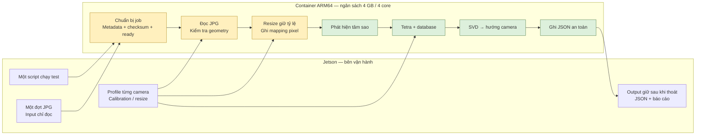
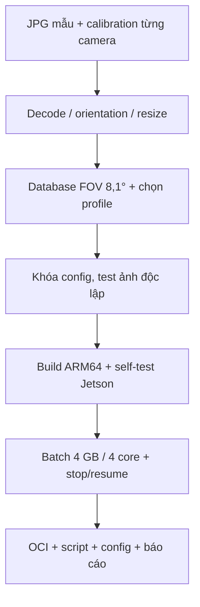

# USSEG Production — Jetson / VinSpace

Cập nhật **05/11/2026**, audit code baseline `d494f0f` trên `prod/version1`.
[Chạy thử](quickstart.md) · [Bằng chứng Podman mới](podman-recheck-20261105.md)

## 1. Yêu cầu sau buổi họp

| Hạng mục | Thông tin nhận được |
|---|---|
| Thiết bị | Jetson “origin nano” 8 GB, dự kiến Orin Nano; cần xác nhận model/OS |
| Ngân sách | 4 GB RAM, 4 core CPU ARM; xác nhận aarch64 và GB/GiB |
| Camera | 16 MP / 24 MP, có cận hồng ngoại; ảnh khoảng 5000×4000 |
| File | JPG; có resize; mount folder input |
| Quang học | Tiêu cự 100 mm; FOV ngang 8,1°, dọc 6,3°, chéo 9,96° |
| Chế độ | Gom một đợt, xử lý lần lượt rồi thoát |
| Kết quả | JSON từng ảnh, trả hướng camera đang nhìn |

5000×4000 là **20 MP**, nên cần kích thước thực theo từng camera.
Bản runtime batch phù hợp; **chưa đủ để bàn giao nguyên trạng cho JPG/camera mới**.

## 2. Pipeline bàn giao dự kiến



Xanh: khối đã có, cần kiểm chứng với camera mới. Vàng: cần thích ứng cho JPG/batch.
Bản này dùng LIS độc lập từng ảnh; tracking chưa tích hợp.

## 3. Khoảng cách giữa source hiện tại và yêu cầu

| Hạng mục | Hiện tại | Cần hoàn thiện |
|---|---|---|
| Batch / JSON / watchdog / resume | Đã có | Test trên Jetson và mount thật |
| JPG | Decoder và publisher chỉ nhận PNG/BMP encoded | Bổ sung JPEG, header/bit depth và orientation |
| Ảnh lớn | max_pixels = 16.777.216 | Giới hạn ảnh gốc/ảnh xử lý phù hợp 20–24 MP |
| Resize | Chưa có trong runtime | Giữ tỷ lệ, lưu kích thước và mapping tọa độ |
| Profile | lab640, stellarium1920 | Profile riêng theo camera/mode |
| Database | Hipparcos, mag 7, FOV 10–30° | Tạo/kiểm chứng database phủ HFOV 8,1° |
| ARM64 | Có wheel hash ứng viên; evidence chỉ amd64 | Xác minh base image, build và test aarch64 |
| Tài nguyên | Một worker, OpenCV/BLAS 1 thread; script chưa áp quota | Đo RAM toàn container và giới hạn CPU/RAM |

Worker chỉ kiểm tra khoảng FOV có giao với database. Nới tolerance để vượt
kiểm tra không chứng minh database phù hợp camera.

### Hình học và resize

Theo pinhole lý tưởng/pixel vuông: FOV 8,1° × 6,3° suy tỷ lệ ảnh **1,2866**
và diagonal **10,2487°**, khác 5000/4000 = **1,25** và diagonal 9,96°.
Với ảnh 5:4, HFOV 8,1° suy VFOV **6,4839°**. Có thể do làm tròn, crop,
distortion hoặc thông số thuộc camera khác; cần xác minh theo camera/mode.

Resize toàn ảnh giữ tỷ lệ thì giữ FOV; crop làm đổi FOV/tâm quang học.
Không kéo giãn sang tỷ lệ khác. Pipeline hiện suy focal pixel từ width/HFOV,
chưa dùng intrinsics tổng quát hoặc distortion calibration.

Nếu ảnh đúng 5000×4000, thử **5000×4000 → 2500×2000 → 1250×1000** trên cùng
dữ liệu, rồi chọn theo accuracy và timing. Đây là ứng viên thử, chưa tối ưu.
Không áp dark RAW trực tiếp vào JPG đã xử lý/nén hoặc giải Bayer lần nữa.
NIR có phân bố độ sáng sao khác catalog quang học.

## 4. Input/output thống nhất

Bên vận hành đưa JPG vào input; script dự kiến tự tạo job. Khi có nhiều camera,
cần ánh xạ ảnh→profile và timestamp nếu có; không đoán camera từ kích thước.

```text
input/                          # chỉ đọc, ảnh của một đợt
config/                         # chỉ đọc, profile từng camera
output/
  prepared/                     # đề xuất: job nội bộ sau bước nhập JPG
  runs/<run_id>/
    results/<result_key>.json
    summary.json
    summary.csv
    health.json
    events.jsonl
  state/                        # checkpoint cho resume
```

`runs/` và `state/` đã có. `prepared/` và nhập tự động cả folder JPG chưa có.
Runtime hiện cần `frame.json` + `frame.ready`; không sửa job đã publish.
Dùng output mới khi đổi source/config/database.

| Trường output hiện tại | Ý nghĩa |
|---|---|
| `job_id`, `input` | Ảnh/profile/timestamp nếu có |
| `status` | solved, no_solve, invalid_input, unsupported_format, timeout, runtime_error, interrupted |
| `pose.ra_deg`, `pose.dec_deg` | Hướng nhìn trên thiên cầu, độ; không phải tọa độ mặt đất |
| `pose.quaternion_wxyz` | Catalog→camera; +X hướng nhìn, +Y trái ảnh, +Z lên ảnh |
| `pose.roll_deg`, `pose.solved_fov_deg` | Roll và FOV solver trả về |
| `algorithm`, `timings_ns` | Centroid/match/config và thời gian từng phần |
| `worker_total_ns`, `supervisor_frame_ns` | Timing theo phạm vi runtime |
| `reference_status`, `provenance` | Chưa có ground truth; nguồn code/config/database |

Không solve thì `pose=null`. `solved` chưa chứng minh hướng đúng; JSON kết quả
không phải nhãn ground truth. Camera→body không nằm trong yêu cầu hiện tại.
Epoch/frame catalog phải được xác minh nếu cần accuracy cao.
Chi tiết schema và phạm vi timing: [runtime](version3-runtime.md).

## 5. Tinh gọn bản bàn giao

- Giữ Python 3.10, NumPy/SciPy/OpenCV headless, pipeline, runtime và database cần dùng.
  Pipeline hiện dùng CPU; chưa cần thêm CUDA/PyTorch.
- Container đã loại docs/out/captures/C++ qua `.containerignore`; số file repo
  không bằng kích thước image hoặc RAM. Giữ fixture đủ self-test.
- Cấu hình production tách preset lab; build ARM64, ghi revision/digest, xuất OCI
  và checksum. Archive amd64 không dùng làm bản native Jetson.
- Áp quota cho self-test và batch, xác minh cgroup trên máy đích. Ví dụ dự kiến
  `--cpus=4 --memory=4g --memory-swap=4g` khi thống nhất 4 GiB và không thêm swap;
  chưa thêm vào script hiện tại.
- Đo peak RAM toàn container. Ảnh 20 MP riêng gray uint8 ~20 MB, float32 ~80 MB;
  decoder/detector có nhiều buffer nên không suy RAM tổng từ dung lượng JPG.

## 6. Test cần làm trước bàn giao



| Test | Điều cần xác nhận |
|---|---|
| JPEG | Gray/màu, ảnh hỏng, header/kích thước sai, EXIF orientation; đúng pixel và lỗi có trạng thái |
| Geometry / resize | Giữ FOV, mapping centroid/reprojection đúng; đủ sao sau giảm ảnh |
| Solver | Simulator/reference đúng FOV và ảnh camera thật; DB phù hợp |
| Accuracy | Correct/wrong/no-solve; quaternion, boresight, roll; tách ảnh chọn config và ảnh đánh giá |
| Hiệu năng | Tối thiểu 100 ảnh đại diện, 1/2/4 thread; startup/load, P50/P95/P99, thời gian toàn batch |
| Tài nguyên | Peak RAM container, CPU, nhiệt độ/throttling; không OOM trong quota |
| Phục hồi | SIGTERM/kill/restart, file chưa hoàn tất, trùng ID, hash sai, hết đĩa; JSON nguyên vẹn |
| Offline | Import OCI, network none, input/config chỉ đọc, output bền vững |

100 ảnh là kiểm tra sơ bộ, chưa chứng minh độ tin cậy mọi tình huống.
Ngưỡng 0,5° của DUST chưa phải tiêu chí VinSpace. Runtime tự đo được thời gian,
tài nguyên và solve rate; accuracy cần reference độc lập.
Throughput toàn batch khác compute FPS và tốc độ chụp camera.

## 7. Bằng chứng và việc cần chốt

[Podman 05/11/2026](podman-recheck-20261105.md): self-test **8/8**, batch **4/4**
có nghiệm; ảnh03 **7 match**, Stellarium **16/16 cặp đúng**, attitude error
**0,002738°**. Đo trên WSL2 amd64 với ảnh lab, chưa phải Jetson/camera mới.
Test decoder/service local: **38 passed**, Python 3.10.

Phía phần cứng cần xác nhận: model/OS/Podman; kích thước và FOV từng camera;
JPG mẫu/mức nén/orientation; reference; đơn vị RAM; sai số và deadline chấp nhận.
USSEG chịu trách nhiệm chọn resize, chuẩn bị script và đo performance.

## 8. Điểm vào source

| Thành phần | File |
|---|---|
| Build/run | `Containerfile`, `scripts/build_podman.sh`, `scripts/run_test.sh` |
| Input | `usseg_runtime/publish.py`, `decode.py`, `config.py` |
| Batch/output | `usseg_runtime/engine.py`, `worker.py`, `storage.py` |
| Thuật toán | `models/pipeline/`, `models/detector/`, `models/identifier/`, `models/attitude/` |
| JSON | `schemas/job.schema.json`, `schemas/result.schema.json` |

Đây là audit và kiến trúc đích; các phần JPG/resize/ARM64 chưa được tuyên bố hoàn thành.
