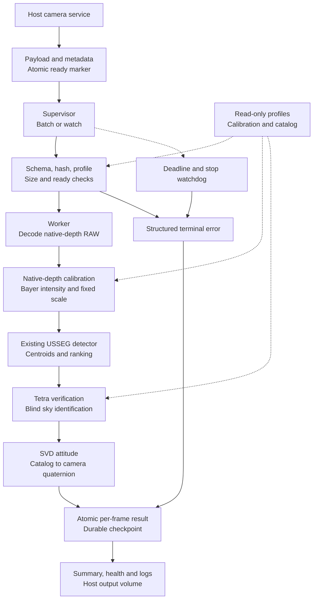

# Version 3 — kế hoạch bàn giao USSEG qua Podman

Ngày: 2026-11-04. Base: `dev/version2`, commit `33d9c17`.
Nhánh làm việc: `dev/version3`. Tài liệu này ghi kế hoạch thiết kế ban đầu.
**Cập nhật triển khai:** batch/watch/self-test, schema draft1.0, explicit unpacked
adapter, durable output và watchdog đã có code; xem [hướng dẫn runtime](version3-runtime.md)
và [báo cáo triển khai](version3-report.md) để biết hành vi đã kiểm thử.
Các mục phần cứng/OCI acceptance ở đây vẫn là điều kiện phải hoàn tất.

## 1. Mục tiêu và phạm vi

Bên phần cứng chỉ cần nạp image OCI, mount thư mục input/output/config rồi chạy
một lệnh. Code, Python 3.10, thư viện và star database nằm trong container.
Không tải package/catalog khi chạy. Không yêu cầu GUI, Stellarium, camera SDK
hay kết nối mạng trong container xử lý ảnh. Host chịu trách nhiệm lấy ảnh camera.

Bản đầu bàn giao Python detector → Tetra → SVD đang có. C++ voting/QUEST/tracking
là pipeline khác, được test riêng ở CI; chưa tích hợp vào kết quả camera của bản này.
LOST và evaluator DUST dùng trên mặt đất để so sánh, không kéo vào runtime bay.
Đầu ra là attitude **camera** cùng trạng thái xử lý. Chưa phát lệnh ADCS và chưa
gọi quaternion đó là attitude thân vệ tinh khi chưa có mounting transform.

Các test theo tính năng trong repo chỉ là một phần của nghiệm thu. Cần bổ sung
test decoder, file đang copy, khởi động/dừng, resume, timeout, hết disk, hết RAM,
đổi camera mode và kiểm tra trên máy chạy Podman thực tế.

## 2. Những gì đã có và còn thiếu

| Thành phần | Hiện tại | Cần làm cho v3 |
|---|---|---|
| Single-image pipeline | BMP/PNG qua OpenCV grayscale; ndarray adapter | Giữ API và kết quả baseline; wrapper runtime riêng |
| Raw camera | Chưa có decoder RG8/RG10/RG12 | Adapter theo format SDK đã xác nhận, golden byte fixtures |
| Dark subtraction | 8-bit grayscale, load một lần | Chế độ raw native-depth trước lượng tử hóa; chống trừ hai lần |
| Intrinsics | Pinhole HFOV, tâm W/2,H/2 | Profile theo ROI/binning/mode; kiểm chứng distortion và mapping trục |
| CLI | Một ảnh, JSON, `ok/no_solve/error` | Batch + watch + self-test, schema output versioned |
| Input readiness | Không có | Payload + metadata + marker ready được publish atomically |
| Độ bền | Output ghi trực tiếp, không journal | Atomic per-frame result, resume, lock và run manifest |
| Timeout | Kiểm tra giữa các tổ hợp pattern | Supervisor + worker, deadline cứng và xử lý worker chết |
| Tài nguyên | Chưa đo trên máy đích | Đo RSS, CPU, startup, throughput, backlog, dung lượng output |
| Container | Chưa có Containerfile/runner | Image Podman offline, pinned dependencies, OCI archive |

Máy phát triển hiện chưa có lệnh `podman`. Nghiệm thu container phải thực hiện
trên host có Podman; không coi Python tests trên host là container tests.

Bảng mục2 mô tả khoảng cách của baseline v2 tại lúc lập kế hoạch. Implementation
hiện tại đã giải quyết một phần các cột cần làm; trạng thái cụ thể nằm trong report.

## 3. Dữ kiện phải chốt với bên phần cứng

**Cập nhật từ người dùng ngày2026-11-04:** chưa có thông số CPU/architecture,
RAM, phiên bản Podman hoặc deadline mỗi ảnh. Cũng chưa có pixel format SDK,
packing/byte layout, mẫu RAW hay xác nhận producer hỗ trợ JSON/ready marker.
Các giao diện ở dưới là đề xuất để hai bên thống nhất, chưa phải khả năng
được bên phần cứng xác nhận.

Trong thời gian chờ, có thể làm schema/validator, batch/watch, durable output,
watchdog và self-test với BMP/PNG lab cùng dữ liệu RAW tổng hợp. Có thể build
image thử nghiệm cho kiến trúc máy phát triển khi có Podman; phải ghi rõ đây
là development image. Golden RAW tổng hợp chỉ kiểm logic unpack, không thay
cho mẫu SDK để chứng nhận decoder camera. Chưa khóa architecture release,
resource budget, camera mode hoặc cấu hình quang học bay.

Chia M1 thành bản draft nội bộ và contract freeze với bên phần cứng. Runner
được xây theo draft có version; chỉ tuyên bố hoàn tất M1 khi producer protocol
được xác nhận. M2 camera integration, M5 và M6 tiếp tục phụ thuộc dữ liệu/host thật.

| Dữ kiện | Vì sao cần | Mốc chặn |
|---|---|---|
| CPU architecture/model, ISA, OS/kernel, Podman version, rootless/rootful | Chọn linux/amd64 hoặc linux/arm64, wheels và quyền volume | Trước build release |
| RAM/CPU/storage quota, temp storage, thời gian shutdown | Chốt resource limit và watchdog | Trước soak/handover |
| Camera model/SDK; pixel format identifier đầy đủ, packed/unpacked, endian, bit alignment | Tránh decoder đọc sai mà vẫn ra ảnh | Trước raw integration |
| Byte sample + ảnh SDK decode chuẩn, stride/header/trailer | Đối chiếu pixel-by-pixel | Trước chứng nhận mỗi format |
| Sensor size, ROI origin/size, binning, Bayer phase, orientation | Đổi camera mode có thể đổi FOV và CFA phase | Trước khóa profile |
| Lens/focal length, effective HFOV, distortion, principal point | Pixel → camera ray đúng | Trước accuracy gate |
| Exposure/gain/temperature/black level/gamma/ISP | Ghép dark/flat và intensity mapping | Trước chọn preprocess |
| Frame cadence, burst size, thứ tự timestamp, thời gian xử lý cho phép | Batch/watch và giới hạn backlog | Trước performance gate |
| Timestamp clock, exposure start/mid/end, camera-to-body matrix | Gắn attitude đúng thời điểm và hệ trục | Trước sử dụng pose downstream |
| Filesystem volume, producer có atomic rename/ready marker hay không | Chống đọc file chưa hoàn chỉnh | Trước contract freeze |

Chưa chốt width/height, bit depth, exposure hoặc FOV bay từ ảnh03/200701.
640×480 và HFOV16.8° chỉ là profile lab có bằng chứng hiện tại.

## 4. Hợp đồng input đề xuất — schema v1

Mount `/input` read-only, `/config` read-only, `/output` read-write. Runtime tạo
state dưới `/output`, không sửa/xóa ảnh camera. Mỗi job có ID duy nhất, không tái sử dụng.

```text
input/
  session_a/
    frame_000001.raw
    frame_000001.json
    frame_000001.ready
config/
  runtime.json
  profiles/camera_mode_a.json
  calibration/camera_mode_a-dark.npy
```

Producer ghi payload và JSON dưới tên tạm trong cùng filesystem, flush/fsync,
rename thành tên chính thức, rồi publish `.ready` bằng rename cuối cùng.
Sau `.ready`, payload/metadata phải bất biến. `.ready` chứa job ID và SHA256
metadata; metadata chứa size/SHA256 payload. Consumer kiểm cả hai trước decode.
File chưa ready được chờ, không bị coi là `no_solve`. Batch snapshot chỉ nhận
ready jobs đã có lúc bắt đầu; watch nhận jobs mới đến khi SIGTERM.

Ví dụ **field set**, giá trị calibration phải do bên camera cung cấp:

```json
{
  "schema_version": "1.0",
  "job_id": "session_a_frame_000001",
  "payload": "frame_000001.raw",
  "payload_size_bytes": 614400,
  "payload_sha256": "REPLACE_WITH_64_HEX_DIGITS",
  "capture_timestamp_utc": null,
  "timestamp_reference": "unknown",
  "clock_source": "unknown",
  "camera_profile_id": "camera_mode_a",
  "pixel_format": "BayerRG12",
  "packing": "unpacked",
  "storage_bits": 16,
  "valid_bits": 12,
  "endianness": "little",
  "bit_alignment": "lsb",
  "width": 640,
  "height": 480,
  "stride_bytes": 1280,
  "header_bytes": 0,
  "trailer_bytes": 0,
  "roi_origin_xy": [0, 0],
  "binning_xy": [1, 1],
  "bayer_pattern_at_roi_origin": "RGGB",
  "orientation": "sensor_native",
  "exposure_us": null,
  "gain_db": null,
  "sensor_temperature_c": null,
  "processing_stage": "sensor_raw",
  "calibration_id": null
}
```

Đây là ví dụ layout 16-bit little-endian/LSB, **không khẳng định camera bên bay dùng layout này**.
Profile duyệt trước quy định các trường nào bắt buộc/cho phép null. Giá trị thiếu
phục vụ decode hoặc geometry phải bị từ chối; không tự đoán từ tên file/dung lượng.
Ảnh encoded BMP/PNG lab cũng đi qua job metadata; decoder lấy header rồi so lại
profile dimensions. Không coi JPEG là fixture đo centroid chính.

Chỉ cho relative payload path trong job directory; cấm absolute path, `..`, symlink
ra ngoài input. Giới hạn file size/dimensions trước allocation, chặn NaN và metadata
trùng field. Profile ID phải khớp allowlist; không cho ảnh tự bật tùy ý detector params.
Thay đổi dimensions, ROI hoặc binning phải chọn profile đã calibration tương ứng.

## 5. RAW và calibration

RG thường chỉ Bayer RG, không đồng nghĩa RGB. `BayerRG12`, `BayerRG12p` và
`BayerRG12Packed` không được gộp thành một decoder. Phải đối chiếu SDK của camera.
[Tài liệu pixel format của Basler](https://docs.baslerweb.com/pixel-format) minh họa
sự khác nhau giữa packed/unpacked; đây không phải xác nhận hãng camera bên bay.

Lộ trình support:

1. Mono8/BMP/PNG grayscale để tái hiện baseline; BayerRG8 theo golden sample.
2. BayerRG10/RG12 unpacked trong uint16, khai báo endian/alignment/stride rõ ràng.
3. Chỉ thêm từng packed format thực sự cần sau khi có mô tả và golden bytes.
   Chưa support thì `unsupported_format`, không decode gần đúng.

Giữ raw native-depth và arithmetic float32 trong calibration. Dark cùng sensor
mode/exposure/gain/temperature, không resize. Dark và black-level offset phải có
quy ước để không trừ cùng offset hai lần. RAW Bayer trừ dark trong cùng mosaic
trước demosaic; ảnh đã corrected không bật subtraction lại. Master 8-bit hiện tại
không dùng trực tiếp cho raw 10/12-bit.

So sánh các phương án chuyển Bayer thành intensity trên dev: demosaic + grayscale,
green-plane hoặc giảm mẫu có kiểm soát. Mỗi phương án ghi effective resolution,
coordinate transform và ảnh hưởng centroid. Chọn một phương án cố định/profile;
không tự thay đổi giữa các frame. Không auto-white-balance/gamma khi chưa calibration.

Sau calibration, scale tuyến tính sang uint8 theo black/white range khóa trong
profile, không clip trực tiếp 10/12-bit về255 và không auto-minmax mỗi ảnh.
Ghi clipping ratio, saturation fraction, dtype/range trước–sau. Detector v3 đầu
tiên vẫn dùng uint8; đánh giá mất sao yếu do lượng tử hóa. Nếu cần detector native
depth, đó là bước thay đổi thuật toán riêng với benchmark mới.

Distortion: profile đầu tiên chỉ được nghiệm thu pinhole khi residual đạt mức
đã chốt. Nếu không, phải triển khai rectification hoặc ray calibration trước
acceptance; lưu mapping centroid về raw pixels và effective intrinsics. Không
claim hỗ trợ distortion chỉ vì schema có trường coefficients.

## 6. Runner, lifecycle và output

Giao diện đích: `/app/run.sh self-test`, `/app/run.sh batch`, `/app/run.sh watch`.
Các path mặc định là `/input`, `/config/runtime.json`, `/output`; override bằng
tham số đã document. Wrapper dùng `exec` để PID1 chuyển signal đúng cho supervisor.

Supervisor xử lý tuần tự, một worker algorithm nạp database một lần. Tái sử dụng
worker với profile bất biến; đổi profile tạo/cấu hình lại worker gồm dark và
intrinsics. Không chỉ gán `pipeline.config` vì `master_dark` đang cache từ init.
Không dùng nhiều worker để tăng FPS trước khi đo memory/time trên máy đích.

Worker gửi handshake `ready` sau load DB. Deadline startup, decode, solve và flush
được cấu hình riêng. Hard deadline áp dụng từ dispatch đến kết quả worker, watchdog
kill/restart worker nếu quá hạn; `solve_timeout_ms` của Tetra vẫn là soft timeout.
Sau SIGTERM: ngừng lấy job mới, finish job đang chạy trong grace, flush kết quả;
quá grace đánh dấu interrupted, terminate child và thoát. SIGKILL/mất điện xử lý
qua journal: khôi phục job chưa có result terminal, retry có giới hạn, không ghi
hai kết quả authoritative cho cùng job/config/input hash. Job lỗi lặp lại không
được làm kẹt toàn bộ queue.

```text
output/
  runs/RUN_ID/
    run.json
    health.json
    results/JOB_ID.json
    summary.json
    summary.csv
    events.jsonl
    previews/                 # tùy chọn, quota rõ ràng
    self-test/                # JUnit + log + fixture results
  state/                     # durable checkpoint + khóa độc quyền
```

Result JSON per-frame là nguồn authoritative. Ghi temp → fsync → atomic rename →
fsync directory trên filesystem được nghiệm thu. State ghi sau result; lúc resume
reconcile result trước checkpoint để tránh nhân đôi. Summary là dữ liệu dẫn xuất,
có thể tái tạo. `events.jsonl` có thể bị tail dở và không dùng thay result.
Run ID mới cho mỗi lần boot, resume liên kết previous run; khóa output tránh hai
container xử lý cùng queue. Duplicate ID cùng hash được skip có log; ID giống
nhưng hash khác là conflict, không ghi đè. Không overwrite run cũ.

Status terminal chuẩn: `solved`, `no_solve`, `invalid_input`, `unsupported_format`,
`timeout`, `runtime_error`, `interrupted`. Mapping API cũ `ok → solved`.
Frame thiếu reference có `reference_status=unavailable`; không đổi `solved` thành
`correct`. `correct/wrong_solve/no_reference` là nhãn evaluator mặt đất, không
phải kết luận runtime tự suy ra.

Mỗi result chứa: schema/run/job ID; input/metadata/config/calibration/DB/source
hashes; capture time + clock/reference; processing time UTC; status/error code;
dimensions/dtype/scale/clipping; centroid count/matches/IDs; residual và heuristic
mismatch probability; quaternion hoặc null; timing, worker restart/attempt.
Mọi số JSON hữu hạn, không NaN/Infinity. Failure có pose=null, không tái sử dụng
quaternion frame trước. Không xuất confidence kiểu calibrated probability từ `Prob`.

Quaternion scalar-first `wxyz`, inertial-catalog → camera, `v_camera = R(q) v_catalog`,
chuẩn hóa, canonical sign. Camera Tetra: +X boresight, +Y về trái ảnh, +Z lên trên;
pixel origin top-left, x sang phải, y xuống. Ghi catalog epoch/equinox/reference
frame thực từ DB; chưa mặc định đây là ECEF hay body frame. `camera_to_body` khi
có sẽ là sản phẩm riêng được kiểm thử reprojection và mounting convention.

Timing dùng monotonic clock: queue, decode, calibration, detection, star-ID,
attitude, output-write, total. Startup/DB-load/warmup tách riêng. Timestamp ảnh
không lấy từ thời điểm file copy. Báo FPS xử lý và số attitude update thành công/s
riêng; khi không có truth không gọi solved FPS là correct-attitude FPS.

Exit codes đích: 0 = batch hoàn thành không lỗi hạ tầng (no_solve là bình thường);
2 = lỗi config/DB/preflight; 3 = batch có terminal frame error;
4 = storage/worker/infrastructure fatal; 130/143 = dừng bởi SIGINT/SIGTERM có ghi
shutdown reason. Watch ghi lỗi từng frame rồi tiếp tục; health và shutdown result
cho biết degraded state. Podman start errors và kill/OOM codes báo riêng từ host.
`health.json` chứa phase, last progress, queue depth, active job và worker restart;
không dùng heartbeat của supervisor để khẳng định solver không bị treo.

Quota: output/results không tự xóa; previews/log có retention/quota cấu hình.
Disk thấp thì ngừng nhận job, ghi health nếu còn ghi được, exit4 để host xử lý.
Memory/CPU limit phải chốt theo đo thực; DB NPZ ~49MB không đại diện peak RSS.
Queue overflow tạo backpressure/health; không âm thầm drop ảnh. Chính sách skip
để giữ realtime nếu cần phải chốt riêng với host và ghi lý do mỗi frame.

## 7. Pipeline v3 đề xuất



Các node supervisor/unpacked decoder/durable output đã được xây trong lượt triển khai;
packed decoder và camera calibration acceptance vẫn chờ SDK/hardware samples.
Pipeline đang chạy thực tế được vẽ riêng trong [báo cáo hiện trạng](current-results.md).

## 8. Container và gói bàn giao

Build bằng Podman với `Containerfile`, image OCI. Python **3.10** cho release đầu;
pin base image digest và exact dependency versions/hashes theo architecture,
OpenCV headless, không GUI/capture libraries ở runtime. Không mặc định mọi Python
3.10–3.14 trong packaging v2 đều được nghiệm thu.

DB được materialize và checksum ở build/staging, đóng gói vào image. Runtime
không gọi `git show origin/main`, không download. Tách dependency runtime và test;
release image chứa self-test fixtures nhỏ và checks cần cho acceptance; CI image
có pytest/C++/full test assets. Nếu đối tác yêu cầu tất cả unit tests trên máy đích,
cung cấp thêm verification image cùng commit thay vì phụ thuộc repo/Internet.

Vận hành offline dùng OCI archive, checksum và `podman load`; Podman có tài liệu
chính thức cho [save](https://docs.podman.io/en/latest/markdown/podman-save.1.html)
và [load](https://docs.podman.io/en/latest/markdown/podman-load.1.html).
Các mount, user mapping và stop behavior phải kiểm trên Podman version đã chốt,
theo [podman run](https://docs.podman.io/en/latest/markdown/podman-run.1.html).

Lệnh minh họa **sau khi build và nghiệm thu image trên host có Podman**:

```bash
sha256sum -c SHA256SUMS
podman load --input usseg-v3-linux-amd64.oci.tar
podman run --name usseg-flight --pull=never --network=none \
  --read-only --userns=keep-id --cap-drop=all \
  --security-opt=no-new-privileges \
  --tmpfs /tmp:rw,nosuid,nodev,size=256m \
  --mount type=bind,src=/srv/usseg/input,dst=/input,ro \
  --mount type=bind,src=/srv/usseg/config,dst=/config,ro \
  --mount type=bind,src=/srv/usseg/output,dst=/output \
  localhost/usseg:v3-RELEASE batch
```

`256m` là ví dụ tmpfs, chưa là quota bay. Host chuẩn bị ownership/path và SELinux
label khi cần; kiểm rootless UID mapping cùng đội vận hành. Không cần privileged
hoặc mount camera device vì input là file. Chốt CPU/memory/pids limits sau đo.
Manifest bàn giao pin image ID/digest, không dùng tag `latest` để nhận diện release.
Architecture trong archive phải khớp host; không coi emulation là chứng nhận ARM64.

Gói release: OCI tar + SHA256SUMS, source commit, build/dependency manifest,
DB/calibration hashes, licenses/catalog redistribution review, schemas, profiles
đã duyệt, `run_test.sh` host wrapper, sample input và expected output, runbook
start/stop/resume, test report trên đúng máy đích, release notes và rollback.
Host wrapper chạy self-test rồi batch tuần tự; lưu chung một run folder và propagate
exit code. Chế độ watch khởi động bằng lệnh riêng vì không kết thúc như batch.

Rollback dùng archive/image ID và profile tương ứng bản đã nghiệm thu trước;
state schema migration phải explicit, không để bản cũ đọc nhầm state mới.

## 9. Kế hoạch triển khai và điều kiện hoàn thành

| Mốc | Công việc/file dự kiến | Điều kiện nghiệm thu |
|---|---|---|
| M0 — baseline | Nhánh v3, docs, freeze hashes/fixtures, report | Trace được baseline v2 và mọi số liệu; đã thực hiện phần tài liệu ở lượt này |
| M1 — contract | `schemas/`, `configs/flight/`, job validator | Ví dụ valid/invalid, producer-consumer thống nhất ready/metadata; camera/host fields bắt buộc đã có |
| M2 — camera adapter | `models/io/`, raw decoder, calibration native-depth | Golden SDK samples bit-exact; stride/packing/ROI/endianness tests pass; no double dark |
| M3 — runtime | `runtime/`, batch/watch, journal, worker/watchdog | 1 job/1 terminal result, restart/resume không mất/nhân đôi, timeout/SIGTERM tests pass |
| M4 — Podman | `Containerfile`, locks, `scripts/run_test.sh`, self-test | Offline load/run trên đúng architecture, ro input/rootfs, writable output, exit codes đúng |
| M5 — camera tuning | Dev/holdout sessions, profiles, evaluator | Chọn mode qua metric trên ảnh camera; calibration/profile version frozen |
| M6 — acceptance | Soak/resource/fault tests, release bundle | Đạt ngân sách đã chốt, cold boot/restart đạt, report và checklist bàn giao ký nhận |

M1 chốt giao diện trước M2/M3; M2 và M3 có thể phát triển với fixtures độc lập.
M4 có thể dựng prototype sớm nhưng release phải dùng M2/M3 hoàn chỉnh. M5 cần
ảnh và calibration thật; M6 cần máy đích. Chưa đưa lịch ngày cố định khi thiếu
camera samples, architecture và resource budget.

Commit dự kiến theo mốc, tránh gom thuật toán/tuning và container vào một commit.
Không merge vào version2; tag release candidate sau khi pass trên máy đích.

Phân công: nhóm software chịu trách nhiệm decoder/runner/image/schema, test và
report; nhóm phần cứng cung cấp samples/SDK reference, producer protocol, host
limits và quyền volume; hai bên cùng duyệt camera profile, acceptance thresholds,
test stop/resume trên máy đích và release manifest. Profile thay đổi sau khi
khóa phải có ID/hash mới và chạy lại acceptance liên quan.

## 10. Bộ test cần chạy

| Nhóm | Dữ liệu / tình huống | Chạy ở đâu | Tiêu chí |
|---|---|---|---|
| Unit/regression | Bộ Python hiện tại, fixture03/200701/Stellarium | CI | Pass; skipped có lý do, release-required không được skip |
| RAW decoder | RG8, 10/12 unpacked, packed đã hỗ trợ, ramp/checkerboard, byte-order/stride sai | CI + self-test mẫu | Pixel equality với golden; lỗi được reject rõ |
| Geometry | Pixel origin, Y, Bayer ROI phase, crop/binning, ray reprojection, q/-q | CI | Camera ray và frame conventions đúng |
| Calibration | Dark cùng mode, saturation, range, already-corrected, mismatch | CI + dev camera | Không overflow/trừ hai lần, mapping cố định và metadata trace được |
| Producer protocol | Partial file, ready trước payload, hash lỗi, thiếu metadata, duplicate/conflict | Podman integration | Không đọc ảnh dở; lỗi terminal/queue state đúng |
| Lifecycle | SIGTERM lúc idle/decode/solve/write; SIGKILL/mất điện; restart giữa result/state | Podman trên host | Không corrupt result, bounded retry, không duplicate terminal |
| Resource | Deadline, worker crash/OOM, disk full, permission denied, input flood | Podman target | Exit/health rõ, không queue hang, resource trong budget |
| Offline | Network none, cold load, không cache/package download | Podman target | Self-test và batch chạy đủ từ bundle |
| Algorithm accuracy | Synthetic + DUST holdout + camera sessions có reference | Ground evaluator | Correct/wrong/no-solve/error và metric đầy đủ, không label leakage |
| Soak | Cadence/burst/backlog thực tế, bật/tắt từ xa | Hardware target | Thời lượng/cycle count và threshold được chốt trước test; không leak/RSS tăng không giới hạn |

Self-test runtime tối thiểu: checksum asset/profile, decode known sample, raw →
centroid → attitude trên fixture có reference, black/corrupt sample, atomic output.
`run_test.sh` không chạy full DUST khi bật container mỗi lần. Full DUST/synthetic
và C++ integration chạy trên mặt đất/verification image; gửi kết quả kèm release.

Đo P50/P95/P99 decode/calibration/detection/ID/attitude/compute/total và cold startup,
peak RSS theo process/cgroup, queue latency, dropped/error counts, disk usage.
Throughput theo cả frame/s và solved update/s. Với reference: quaternion error,
boresight, roll, solve/correct/wrong rate, detection recall/residual, ID correspondence,
macro theo session và micro theo frame. Sequence outage tính từ timestamp hợp lệ,
không lấy số frame làm giây khi cadence chưa cố định.

Quality gates: ảnh fixture hiện có tái hiện trong tolerance định trước; không giảm
accuracy có ý nghĩa trên holdout sau decoder/calibration; false-solve budget được
định trước cùng số lượng negatives đủ. Lab fixtures pass không đủ chứng nhận bay.
Các con số latency/FPS/RAM/accuracy mục tiêu bay đang **TBD**, không tự gán đạt.

## 11. Chọn cấu hình camera

Nhận cùng field với RG8/RG10/RG12, các mode resolution/ROI/binning ứng viên,
exposure/gain được kiểm soát và dark tương ứng. Capture nhiều vùng trời, brightness,
background, motion blur, thermal conditions; metadata gắn từng frame. Chia dev/test
theo session, không chia ngẫu nhiên các frame tương quan. Reference plate solve
dùng sau inference; WCS là pseudo-ground-truth, không đưa center/Corr vào solver.

Trước tiên kiểm SDK decoder/geometry, rồi so độ nhạy sao, saturation/clipping,
centroid, correct/wrong solve và chi phí xử lý. Chọn cấu hình theo tradeoff accuracy,
throughput, dung lượng và ràng buộc camera; khóa trước holdout. Ảnh sao thật từ
camera bay là điều kiện xác nhận mode cuối. Không dùng FOV16.8° của ảnh lab làm
giá trị mặc định áp cho mọi ảnh trên quỹ đạo.

## 12. Trả lời bên vận hành

Repo hiện có thư viện, các test theo tính năng và một số ảnh kiểm thử. Bản bàn
giao dự kiến sẽ có một image OCI chạy bằng Podman, kèm script chạy self-test và
xử lý thư mục input tuần tự; kết quả JSON/CSV/log lưu vào folder output được mount.
Bên camera publish ảnh, metadata và tín hiệu ready; container đọc và trả attitude
camera hoặc trạng thái không giải được/lỗi cho từng ảnh. Có chế độ watch cho ảnh
đến liên tục và resume sau khi tắt/bật. Test benchmark đầy đủ sẽ chạy trên mặt đất
và đính kèm báo cáo release. Cần chốt pixel format byte layout, camera mode,
CPU/RAM và thời gian xử lý trước khi đóng bản bàn giao cuối.
