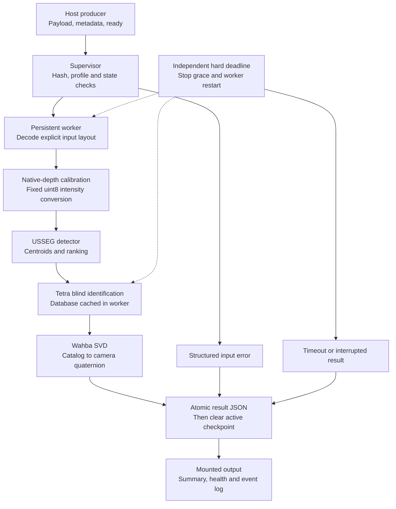
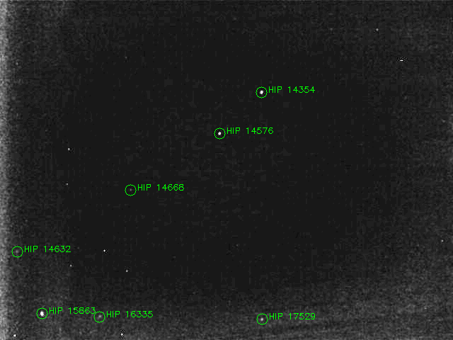
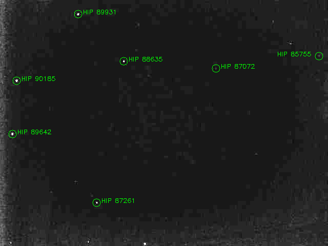
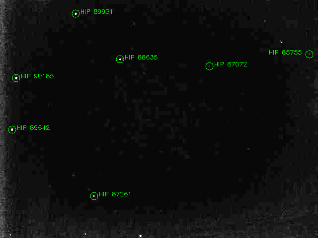
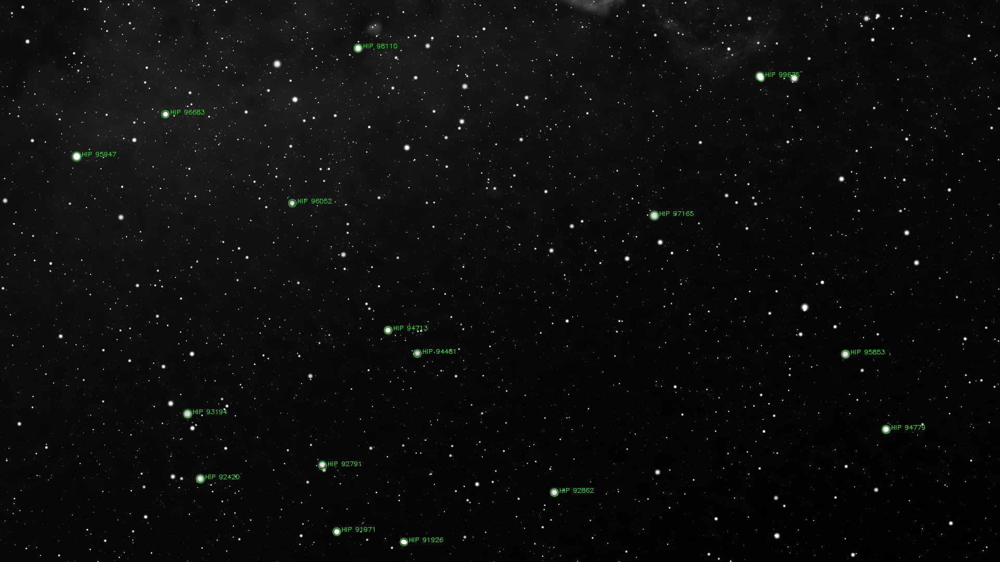

# Version3 — báo cáo triển khai và kiểm thử

Ngày: **2026-11-04**, nhánh `dev/version3`, phát triển từ version2 `33d9c17`.
Đây là bản runtime development theo hợp đồng draft1.0. Camera format/host hardware
chưa được đối tác xác nhận; nghiệm thu bay vẫn phụ thuộc các dữ kiện đó.

## 1. Những phần đã triển khai

| Thành phần | Kết quả |
|---|---|
| File runtime | `usseg_runtime`: batch, watch, self-test, publisher prepare-input |
| Input protocol | Payload + JSON metadata + ready marker; size/hash/profile validation; không đọc file chưa ready |
| Decoder | PNG8/BMP; explicit unpacked Mono/BayerRG8/10/12; endian/alignment/stride/header/trailer; packed bị reject |
| Calibration | Optional native-depth dark, fixed scale, no unsigned wrap; chặn trừ dark hai lần |
| Worker | Database nạp một lần; profile switch có kiểm FOV; một worker xử lý tuần tự |
| Deadline | Watchdog độc lập, kể cả IPC nghẽn; kill/restart worker khi timeout |
| Persistence | Result fsync/atomic rename; active checkpoint, exclusive lock, reconcile result trước resume |
| Stop/restart | SIGTERM grace, interrupted retry giới hạn; Linux parent-death signal; recovery sau SIGKILL |
| Output | JSON mỗi marker, run manifest, summary JSON/CSV, health, rotating events; provenance hashes và dependency versions |
| Podman packaging | Pinned OCI base, headless runtime wheel hashes, Containerfile, offline archive build script, host run-test script |
| Verification | Ground suite tuần tự, self-test JUnit/JSON, camera overlays, fault/decoder tests |

Source chính: `usseg_runtime/`; config: `configs/runtime/`; schema: `schemas/`.
Detector/Tetra/SVD cũ không bị sửa trong lượt triển khai này. Wrapper tái sử dụng
pipeline với camera profile khóa và adapter input rõ ràng.

## 2. Pipeline implementation



Pose là camera attitude, chưa có camera-to-body transform. `solved` được giữ
riêng với đánh giá `correct`; các ảnh không có WCS không được tự chấm đúng.

## 3. Kiểm thử thực đo

| Lượt kiểm chứng | Kết quả | Bằng chứng |
|---|---|---|
| Python regression + runtime | **105 passed, 2 skipped** | [JUnit](evidence/version3/pytest-junit.xml), [log](evidence/version3/pytest.log) |
| Self-test headless dependency lock | **8 checks passed, 0 failed** | [Report JSON](evidence/version3/headless-self-test.json) |
| Camera smoke headless | **4/4 solved** | [Report JSON](evidence/version3/camera-headless.json) |
| JSON Schema | 8 job +8 ready +8 result hợp lệ trên ground fixtures | Draft2020-12 validation thực hiện bằng jsonschema4.23.0 |
| C++ LIS | 5/5 IDs đúng, rotation error khoảng4.94e−10° | [Log](evidence/version3/cpp-lis.log) |
| C++ tracking | 5/5 true matches, loại2 outliers; QUEST path chạy thành công | [Log](evidence/version3/cpp-tracking.log) |
| C++ preprocessing | **Pass**, đọc calibrated BMP, ROI và xuất3 ảnh | [Log](evidence/version3/cpp-preprocessing.log) |
| Podman build/load/run | **Pass** trên Podman4.9.3 rootless, Ubuntu24.04/WSL2 amd64 | [Container evidence](evidence/version3/podman-validation.json) |

Container build từ commit `5719b7b`, image ID
`4052931d2a591628eff24e954a9a880e7d53fa2149f8165f99c40cff8fb03f6c`.
Đã xuất OCI archive, kiểm SHA256, nạp lại bằng `podman load` và chạy script
`run_test.sh` hai lần: mỗi lượt self-test **8/8**, batch đầu **4/4 solved**,
batch sau không tạo thêm kết quả (tổng vẫn4). HIP IDs giống baseline;
RA/Dec/HFOV lệch dưới1e−9°. Stellarium attitude error **0.002737686°**.
Probe trong container xác nhận UID1000, chỉ có network interface loopback,
`/app` và `/input` từ chối ghi với EROFS, `/output` ghi được.
Cảnh báo shared mount ban đầu không gây lỗi các bind mounts đã kiểm tra.
Đây là kiểm chứng trên máy phát triển, chưa phải nghiệm thu phần cứng bay.

| Ảnh trong Podman | Matches | Worker time (ms), một lượt |
|---|---:|---:|
| 03.bmp | 7 | 141.222 |
| 200701.bmp | 7 | 45.731 |
| 200701_calibrated.bmp | 7 | 49.065 |
| Stellarium | 16 | 409.626 |

Timing smoke trên WSL2 không dùng để kết luận container nhanh hơn host.

Hai Python skips là các suite CSV ngoài repo; không che lỗi runtime-required.
RAW golden tests tổng hợp kiểm ramp, Bayer phase,10/12-bit LSB/MSB, endian và row
padding. Chưa có SDK golden sample từ camera bay để chứng nhận decode vật lý.

Fault tests thực sự gửi SIGSTOP cho worker, buộc IPC vượt pipe capacity rồi kiểm
deadline; gửi SIGTERM để kiểm grace/interrupted, SIGKILL supervisor để kiểm recovery;
kiểm output lock, disk-budget failure, payload sai hash, file chưa ready, metadata
trùng key, symlink/traversal, duplicate/conflicting job IDs và terminal pose=null.
Recovery dùng attempt counter thay UUID thứ tự thư mục, tránh xử lý nhầm run cũ.

## 4. Kết quả ảnh qua runtime mới

Python3.10.21, NumPy1.24.4, SciPy1.10.1, OpenCV-headless4.7.0.72,
Pillow10.4.0; installation khóa hashes đã thành công trong `.venv-runtime` sạch.
Mỗi ảnh dùng pixels như file cung cấp, không trừ dark thêm; white range0–255,
profile lab640 HFOV16.8° hoặc profile Stellarium đã có.

| Input | Status | Matches | RA / Dec (độ) | HFOV (độ) | Fit RMSE (arcsec) | Worker time (ms) |
|---|---|---:|---|---:|---:|---:|
| 03.bmp | solved | 7 | 48.816336 / 41.369726 | 16.747193 | 38.896 | 222.438 |
| 200701.bmp | solved | 7 | 267.250966 / −31.683422 | 16.767348 | 42.418 | 26.620 |
| 200701_calibrated.bmp | solved | 7 | 267.256413 / −31.683188 | 16.765450 | 42.698 | 40.766 |
| Stellarium | solved | 16 | 291.950409 / 41.128080 | 29.712974 | 46.251 | 786.221 |

Worker time là một lần chạy development, gồm read/hash/decode/calibration và
algorithm, không gồm startup/output commit. Chỉ4 ảnh, máy đồng thời compile C++;
không coi percentile/FPS ở đây là benchmark latency hoặc cam kết CPU bay.
DB-load gồm worker imports/init khoảng2.48s; worker starts=1.
Peak worker RSS219.7MiB (224984KiB), không phải container/cgroup memory peak.

Stellarium attitude error so nhãn: **0.002737686°**,16/16 labeled ID pairs đúng.
Ảnh03 giữ cùng nghiệm cũ, approximate center discrepancy khoảng0.033° so
Astrometry screenshot; chưa có WCS gốc cho full attitude/roll. Hai ảnh200701
giữ cùng7 HIP IDs với kết quả version2, chưa có reference độc lập.
Residual fit không được trình bày như attitude accuracy.

### Ảnh kết quả runtime mới

Chỉ vẽ HIP IDs solver trả về; gain8 ở ảnh camera chỉ để hiển thị.









## 5. Cách chạy lại

```bash
# Mặt đất: Python tests, self-test, camera smoke và C++ khi đủ toolchain.
bash scripts/verify_local.sh out/v3-verification-new

# Host có Podman, sau khi checkout commit sạch và chuẩn bị DB.
USSEG_PYTHON=.venv/bin/python bash scripts/build_podman.sh out/podman-release
# Host mount paths: INPUT, OUTPUT, CONFIG; CONFIG/runtime.json là external config.
bash scripts/run_test.sh /srv/usseg/input /srv/usseg/output /srv/usseg/config
```

Chi tiết publish RAW/ready, exit codes, stop/resume, schema và layout output:
[version3-runtime.md](version3-runtime.md). Hợp đồng producer vẫn draft, cần thống
nhất với hardware. OCI development đã build và kiểm trên WSL2, nằm tại
`out/podman-release/usseg-v3.oci.tar` cùng `SHA256SUMS` và `image-inspect.json`;
archive không đưa vào Git. Image chứa source commit `5719b7b`; các cập nhật
báo cáo sau commit đó không thay source runtime trong archive.

## 6. Các mục còn chờ trước bàn giao bay

- Host CPU/architecture/RAM/Podman version; quota và deadline/grace thật.
- SDK pixel format/packing và byte sample + SDK decoded reference; kích thước,
  ROI/binning/Bayer phase, exposure/gain/thermal và calibration profile.
- Podman build/load/run offline trên đúng host; UID/volume/SELinux và cgroup/OOM tests.
- Camera holdout accuracy, calibrated distortion/mounting/time reference khi cần.
- Sustained cadence/backlog/soak và power-cycle trên filesystem thật; release
  dependency/license review, archive hashes và rollback acceptance.

Full LOST/DUST holdout chưa chạy lại trong lượt xây runtime. [Báo cáo baseline](current-results.md)
giữ số liệu lịch sử; không dùng4 ảnh smoke để thay accuracy trên dataset.
Tài liệu trùng/lỗi thời đã dọn, lịch sử còn ở version2; artifacts kiểm chứng mới
được chọn lưu trong `docs/evidence/version3/` để báo cáo đi cùng source checkout.
